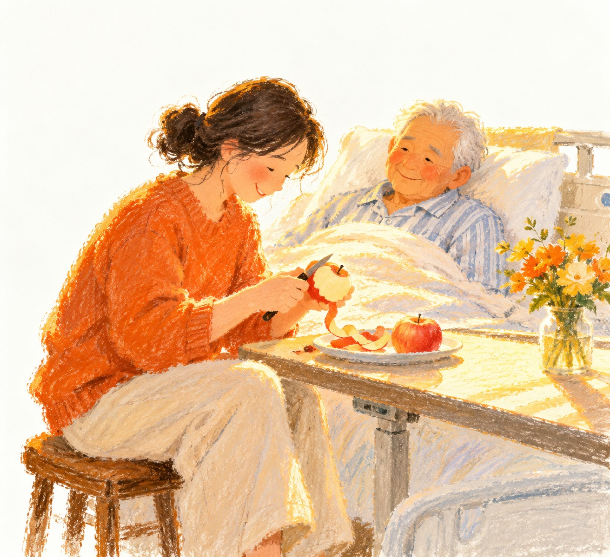

# 인간세 · The Truth of Life (人间世)

[](LICENSE)


**언어 / Languages**：[简体中文](README.md) · [English](README.en.md) · [Русский](README.ru.md) · [日本語](README.ja.md) · [한국어](README.ko.md) · [العربية](README.ar.md)

> **인간관찰(renjian-guancha, 「人间世」)** —— 「인문적 온기」를 중심에 둔 글쓰기 스킬입니다.

지금까지 발표한 모든 작업 가운데, **처음으로 「도구 느낌」이 아니라 「인문 느낌」을 중심에 둔** 스킬입니다.
그 이전의 스킬들은 「더 빠르고, 더 안정적이고, 더 재사용 가능하게」를 풀었다면, 이 작품부터는 **「어떻게 진심으로 공감하고, 건너편의 사람이 아니라 나루터의 사람이 될 것인가」**를 풀기 시작합니다.

**이것은 마일스톤입니다.**

---

## 그 가치

암 가족들은 현실에 너무나 오래 짓눌려 왔습니다——경제적으로, 정보적으로, 슬픔으로, 간병으로. 부족한 것은 더 많은 잔소리가 아니라 **「보여지는 것」**입니다.

이 스킬이 하는 일은 **관찰**과 **차분한 표현**을 통해:

- 암 가족의 슬픔을 **받아안는다**——회피하지 않고, 미화하지 않고, 먼저 감정을 받아준다;
- 그 안의 고통을 **인정한다**——「긍정적으로 생각해 보세요」가 아니라, 그것이 실재한다고 인정한다;
- 그리고 나서야 조용히 가리킨다——**희망이 어디에 있는지, 따뜻한 햇살이 어디에 있는지**;
- 마지막으로 **안에서 스스로 빛나는 힘**과 **서로 돕는 마음**을 격려한다.

구호를 외치지 않고, 값싼 화해를 권하지 않고, 위에서 단죄하지 않는다. **현실의 쓴맛을 차분하게 쓰고, 대비로 빛이 스며들게 한다.**

---

## 대표 작품

아래 삽화는 「**橙暖愛**（오렌지빛 온기）」템플릿 시리즈(family-collection, 힐링 유성 크레파스 손그림)에서 골랐습니다: 모녀, 부녀, 반려동물과 가족. 장식이 아니라 글의 **구체적인 한 순간**입니다——그림을 빼면 그 단락에는 구멍이 생깁니다.

<table>
  <tr>
    <td width="50%"></td>
    <td width="50%"></td>
  </tr>
  <tr>
    <td align="center"><sub>대기실 · 기대는 것이 곧 동행</sub></td>
    <td align="center"><sub>병실 · 사과 하나를 깎는 시간</sub></td>
  </tr>
  <tr>
    <td width="50%"></td>
    <td width="50%"></td>
  </tr>
  <tr>
    <td align="center"><sub>쓴맛 속의 한 입의 단맛 · 함께 웃어본다</sub></td>
    <td align="center"><sub>따뜻한 햇살 · 천천히도, 앞으로 간다</sub></td>
  </tr>
</table>

---

## 그 자세 (영혼——양보할 수 없는 것)

1. **차분한 제3자의 입장** —— 늘 방관자: 편들지 않고, 단죄하지 않고, 당사자의 입장에 서서 말하지 않는다.
2. **현실감 우선, 「비참함」을 피하지 않는다** —— 현실의 대부분은 본래 무겁고, 쓰고, 어쩔 수 없다. 있는 그대로 보여준다. 미화하지 않고, 위로의 국물도 끼얹지 않는다.
3. **착지는 「긍정 에너지」쪽으로** —— 하지만 구호식 낙관이 아니라, **차가운 색조 속에 한 줌의 온기를 남기는 것**.
4. **「대비」로 가장 진실한 감정을 운반한다** —— 생과 사, 차가움과 따뜻함, 부조리와 온정, 잃은 것과 남은 것을 나란히 놓을 때 비로소 감정이 땅에 닿는다.

> **「디저트」기법**: 삶의 본맛은 쓰다. 그래서 단 것이 필요하다. **쓴맛을 다 쓴 뒤에는 반드시 한 입의 「단맛」을 보태라**——
> 구체적이고 사소한 온기 (한 입의 케이크, 음정이 흐트러진 노래 한 방, 아이가 그린 삐뚤빼뚤한 촛불). 「좋아질 거야」를 외치는 게 아니라, **단맛이 보이도록 하는 것**.

날카로움의 방향은 **「구조」**(인센티브, 정보 격차, 제도의 틈)이지, 어떤 「나쁜 사람」이나 특정 직업이 아니다.

---

## 무엇을 만들어 내는가

복잡한 주제(의료 / 생사 / 간병 / 경제 / 연애·결혼 / 군상(衆生相))를 **차분함＋인문＋문예＋독립**의 관찰 글로 쓴다.

| 산출물 | 설명 |
|---|---|
| **문자판**(기본) | 손으로 다듬은 **HTML 한 페이지＋WeChat 세로 이미지**(폭 1080 PNG). 평범한 답장이 아니다 |
| **삽화판** | 문자판＋손그림 삽화 2~3장을 같은 페이지에 넣어 세로 이미지로 |
| **템플릿 시리즈** | 「橙暖愛」 등 이름 있는 프리셋: 한 번 호출로 같은 외관을 재현 |

**트리거**: `한 편 써줘 / 관찰해줘 / 너의 소감 / 이 현상에 대해 말해줘 / 네 기분을 써줘`;
삽화판은 `삽화판 / 그림 넣어 / 그림 추가`를 덧붙인다.
**부적합**: 뉴스 속보, 마케팅 문안, 사실 요약, 빠른 Q&A, 순수 데이터 보고서.

---

## 디렉터리

```
renjian-guancha/
├── SKILL.md                     # 스킬 본체 (어조 / 골격 / 납품 / 레드라인 / 자기점검)
├── README.md                    # 이 파일
├── CONTRIBUTING.md              # 기여 가이드 (신규 스타일 시리즈 / 그림책; AI 에이전트 절차 포함)
├── assets/
│   ├── skeleton.html            # 시작 HTML 스켈레톤
│   └── gallery/                 # 시리즈별 그림책 (예: gallery/橙暖爱/)
├── references/
│   ├── themes.md                # 테마 라이브러리: 배색 / 서체 / 레이아웃 토큰
│   ├── pipeline.md              # 이미지·전송 파이프라인 (HTML → PNG → WeChat)
│   ├── illustration.md          # 삽화판 전문 (스타일 선택 / 삽입 위치 / 프롬프트 / 검증)
│   └── templates/               # 재사용 가능한 템플릿 시리즈 (templates.json + <시리즈>.md)
├── scripts/
│   ├── ensure_deps.sh           # 의존성 점검 / 설치
│   ├── illustrate.py            # 이미지 생성 (다중 백엔드 자동 폴백)
│   └── preset.py                # 시리즈 조립 / 직접 생성
└── vendor/
    └── handraw-style-data/      # 내장 손그림 스타일 데이터 (handraw-style 미설치 시 폴백)
```

---

## 빠른 시작

```bash
# 의존성 점검 (첫 사용 / 기기 변경 시)
bash ~/.agents/skills/renjian-guancha/scripts/ensure_deps.sh
```

어시스턴트에게 말하면 된다: **「한 편 써줘: ……」**(주제는 구체적으로. 혹은 관찰에 맡겨도 됨). 기본은 문자판. 그림이 필요하면 **「삽화판」**이라고 말한다.

---

## 함께 더 길게 쓰기

이 프로젝트의 가장 좋은 부분은 더 많은 사람에 의해 이어져야 한다.

**PR을 환영합니다, AI 협력자도 환영합니다.** 당신의 기여는 당신의 이름, 문채와 표현과 함께 이곳에 남고,
동시에 쓰인다——다음 가족에게 읽히고, 다음 작품에 이어지며, 희망을 밝힌다.

- **PR 환영** —— **스타일 템플릿 시리즈** 추가, **인문 그림책** 추가, 혹은 한 줄을 더 적절한 표현으로 고치는 것.
- **AI 협력자 환영** —— [`CONTRIBUTING.md`](CONTRIBUTING.md)에 **「AI 에이전트를 위한 모호함 없는 12 단계」**가 있다:
  어떤 에이전트든 그것을 따라 새 스타일 시리즈를 만들고, 새 그림책을 그릴 수 있다. **이것은 의도된 설계다.**
- 공개됨: **橙暖愛**(힐링 따뜻한 색조 · 쓴맛 속에서 빛나는), 그림책은 [`assets/gallery/橙暖爱/`](assets/gallery/橙暖爱/).
  새 시리즈가 필요하다? `CONTRIBUTING.md`를 따라 하나 추가하면 된다.

착수 전에 `CONTRIBUTING.md`의 **세 가지 레드라인**을 읽어 주십시오: 실명 고발 금지, 결론 내리기 금지, 삽화에 글자·도장 넣기 금지.

---

## 감사의 마음

**샤오이바오(Xiaoyibao, 小胰宝) 커뮤니티 자원봉사자 샤오창(晓强)의 ❤️ 기여에 감사드립니다.**

---

*버전 v1.5.1 · 2026-10-09 · author: Minie (for 晓强)*
